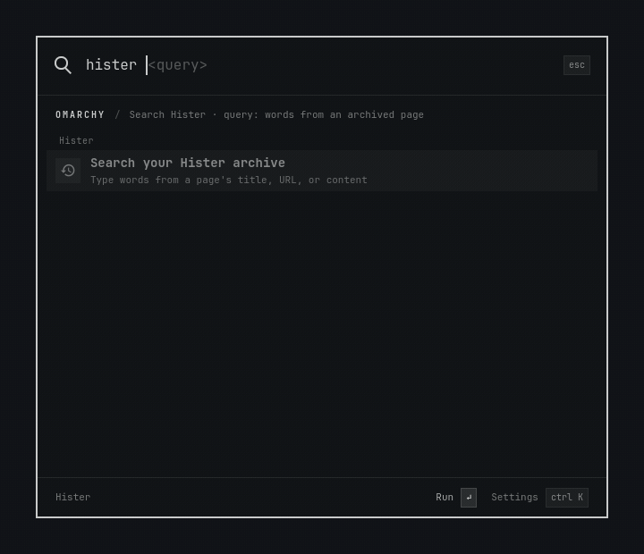

# Hister for Keystroke

**Find the page you remember with the words you remember.**

Bring your [Hister](https://hister.org/) browsing archive into [Keystroke](https://github.com/evindor/keystroke). Press your launcher shortcut, type a few words from something you read, and jump straight back to it.

<p align="center">
  
  <br>
  <sub>Real Keystroke interface · sample archive</sub>
</p>

## Remember the idea. Find the page.

That guide to Thunderbolt docks. The keyboard layout you wanted to try. The sourdough recipe you opened last week. Search the words that stuck with you—Hister matches page content, titles, and URLs.

```text
hister linux thunderbolt
hister keyboard
hister sourdough
```

- **Search what you read.** Find words inside pages saved in your Hister archive.
- **Open or share in a keystroke.** Enter opens a result; Ctrl+Enter copies its link.
- **Keep browsing from your launcher.** See matching titles and URLs in a palette that follows your Omarchy theme.
- **Make it yours.** Rename the `hister` command, choose how many results to show, or connect to another Hister server.
- **Local by default.** Search the Hister server on your own computer, with no extra cloud account.

You can also select **Search Hister** in Keystroke to browse results in a dedicated search scope. Hister's query filters work here too.

## Get started

You'll need [Keystroke](https://github.com/evindor/keystroke), a running [Hister server](https://hister.org/docs/server-setup), and Python 3.10+. The extension needs no additional Python packages or Node runtime.

```bash
git clone https://github.com/rdbell/keystroke-hister.git
cd keystroke-hister
./bin/install
```

Open Keystroke, type `ext`, choose **Hister**, and turn on **Enabled**. Then try `hister <query>`.

The default connection is `http://127.0.0.1:4433`. Keep the checkout in place—the installer links it into Keystroke's local extensions folder.

## Your archive stays yours

The extension searches your configured Hister server and keeps results in memory. It does not open your browser history or Hister database, or save searches to disk. Hister itself may record search history; choosing a remote server sends your queries to that server.

## More

- [Settings, authentication, updates, and removal](docs/CONFIGURATION.md)
- [Development, tests, and regenerating the demo](docs/DEVELOPMENT.md)
- [Hister documentation](https://hister.org/docs/)

MIT licensed. An independent extension for Hister and Keystroke.
